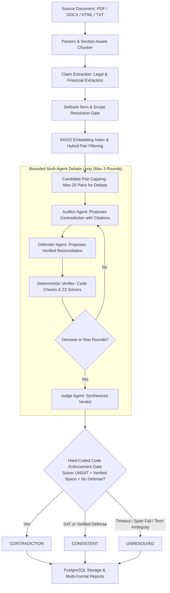
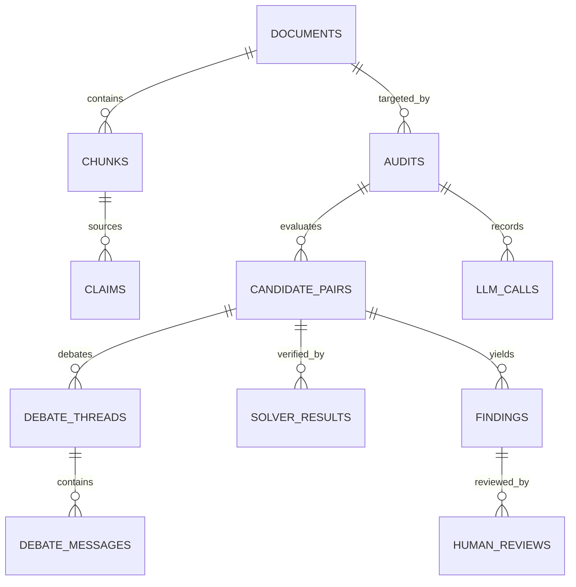

# System Architecture & Code Guarantees

This document details the architecture, component interactions, database schema, verdict decision table, and exact code locations where core audit guarantees are enforced.

---

## 1. End-to-End Pipeline

---

## 2. Component & Module Map

| Module | Core Responsibility | Key Files |
| :--- | :--- | :--- |
| `schemas/` | Immutable Pydantic v2 domain schemas with validation invariants. | `span.py`, `chunk.py`, `claim.py`, `pair.py`, `solver.py`, `debate.py`, `finding.py` |
| `ingestion/` | Multi-format parsing, section-aware chunking, table extraction, exact offset mapping. | `base.py`, `pdf.py`, `docx.py`, `html.py`, `txt.py`, `chunker.py` |
| `extraction/` | Versioned prompt execution, span verification, defined-term glossary pass, LLM telemetry. | `provider.py`, `verifier.py`, `legal.py`, `financial.py`, `defined_terms.py` |
| `symbolic/` | Formal Z3 SMT numerical/temporal solvers, Horn deontic logic, defined-term scope gates. | `numeric_temporal.py`, `deontic.py`, `terms.py`, `pipeline.py` |
| `retrieval/` | Offline local Hugging Face embeddings (`all-MiniLM-L6-v2`), FAISS vector index, candidate generator. | `embedder.py`, `faiss_index.py`, `candidate_pairs.py` |
| `agents/` | Auditor, Defender, Judge agent wrappers, deterministic verifier, bounded debate loop. | `auditor.py`, `defender.py`, `judge.py`, `verifier.py`, `debate_loop.py` |
| `eval/` | Contradiction injection engine, public dataset loaders, 3 benchmark systems, metrics, caching. | `injection/injector.py`, `data/loaders.py`, `systems/runners.py`, `metrics/calculator.py` |
| `storage/` | SQLAlchemy 2.0 PostgreSQL relational schema and database connection management. | `database.py`, `models.py` |
| `api/` | FastAPI REST service, background audit execution worker, report generator. | `main.py`, `worker.py`, `reports.py`, `schemas.py` |
| `ui/` | React 18 + TypeScript Vite frontend, exact offset highlighter, evidence viewer. | `src/App.tsx`, `src/components/`, `src/pages/` |

---

## 3. Database Schema

---

## 4. Verdict Decision Matrix

| Solver Outcome | Spans Verified? | Term Scope Resolved? | Valid Defense Proven? | Final Verdict | Severity | Code Action |
| :--- | :--- | :--- | :--- | :--- | :--- | :--- |
| `UNSAT` | **Yes** | **Yes** | **No** | `CONTRADICTION` | `HIGH` / `CRITICAL` | Confirmed contradiction; unsat core attached. |
| `UNSAT` | No | Any | Any | `UNRESOLVED` | `MEDIUM` | Downgraded: citation missing or fabricated. |
| `UNSAT` | Yes | No | Any | `UNRESOLVED` | `MEDIUM` | Downgraded: conflicting term definitions or unit mismatch. |
| `UNSAT` | Yes | Yes | **Yes** | `CONSISTENT` | `INFO` | Neutralized: verified contractual exception applies. |
| `SAT` | Yes | Yes | Any | `CONSISTENT` | `INFO` | Proven mathematically / logically consistent. Overrules Judge if Judge claimed contradiction. |
| `UNKNOWN` | Any | Any | Any | `UNRESOLVED` | `MEDIUM` | Solver timeout or unsupported logic; flagged for human review. |

---

## 5. Code Enforcement Index

The project's non-negotiable guarantees are hard-coded into the following files:

1. **Exact Offset Span Verification**:
   - `extraction/verifier.py` (`SpanVerifier.verify_claim`): Ensures `full_text[char_start:char_end] == text_snippet`. Drops malformed or hallucinated spans immediately.
   - `agents/verifier.py` (`DeterministicVerifier.evaluate_pair`): Re-verifies both claim spans against source text before solver execution.
2. **Hard-Coded Code Gate & Judge Overrule**:
   - `agents/debate_loop.py` (lines 160–192):
     Enforces that `CONTRADICTION` is emitted **only** when solver is `UNSAT`, spans are verified, terms are resolved, and no valid defense exists. Overrules hallucinatory Judge verdicts to `CONSISTENT` or `UNRESOLVED` (`judge_overruled = True`).
3. **Solver UNKNOWN / Timeout Mapping**:
   - `schemas/finding.py` (`Finding` validation): Enforces that `CONTRADICTION` requires `solver_outcome == UNSAT`. Any `UNKNOWN` or `SAT` outcome is forbidden from emitting a contradiction status.
4. **Token & Cost Budget Guards**:
   - `agents/debate_loop.py` (lines 75–88): Enforces per-pair token caps (`8,000`), per-pair cost caps (`$0.15`), and per-document cost caps (`$2.00`). Terminates debate and marks remaining pairs `UNRESOLVED` upon breach.
   - `eval/metrics/cache.py` (`EvalResultCache.track_cost_and_check_budget`): Enforces `hard_cost_limit_usd` across evaluation runs.
5. **Human Review Immutability**:
   - `api/main.py` (`submit_human_review`): Stores human decisions (`confirm | dismiss | needs_more_info`) in the separate `human_reviews` table. Never modifies the underlying `Finding.status` or `solver_result`.
